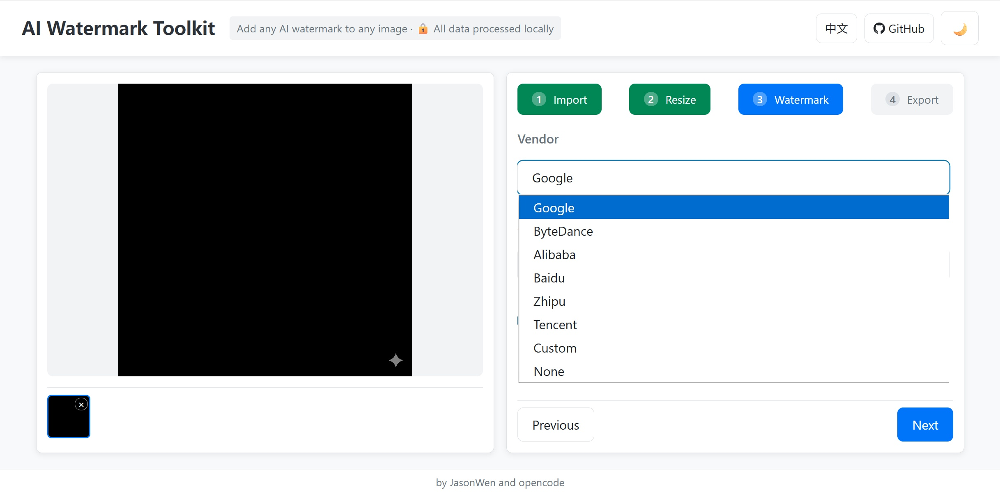

# VibeMark

**VibeMark** is a lightweight, high-performance, and privacy-first AI watermark toolkit. It allows you to add professional AI watermarks from top-tier vendors to your images with just one click. Designed as a single-file HTML application, it runs entirely in your browser, ensuring your data never leaves your machine.

## ✨ Core Selling Points

- **One-Click AI Watermarking**: Instantly apply watermarks from top vendors like Google, ByteDance, Alibaba, Baidu, Tencent, and more.
- **Dozens of Channels**: Pre-configured presets for various AI generation platforms.
- **Privacy First**: 100% local processing. Your images never leave your browser.
- **Single-File App**: A portable HTML file with no installation or dependencies required.

## 🚀 Key Features

- **Multi-Vendor Presets**: Support for Gemini, Doubao, Qwen, Wenxin, Hunyuan, and many others.
- **Intelligent Auto-Scaling**: Watermarks automatically adjust to match the target image resolution and style.
- **Precise Control**: Fine-tune position, opacity, and offsets with ease.
- **Interactive Editing**: Integrated crop and resize functionality with intuitive drag-and-drop interaction.
- **Custom Watermarks**: Support for custom text and image watermarks.
- **Batch Processing**: Process multiple images simultaneously and export them as a ZIP archive.

## 🛠️ Access & Deployment

You can use VibeMark directly via the following links:
- [Cloudflare Demo](https://vibemark.pages.dev/)
- [Vercel Demo](https://vibe-mark-ivory.vercel.app/)
- [GitHub Pages](https://jasonwenthefox.github.io/VibeMark/)

Alternatively, download `index.html` and open it locally.

## 🚧 TODO & Missing Assets

We are looking for contributions to add missing vendor assets:
- **Grok** (xAI)
- **Adobe Firefly**

If you have high-quality, black-background source marks for these or other AI vendors, please open an issue or submit a pull request!

## 🤝 Contributing

Contributions are welcome! Help us make VibeMark the ultimate AI watermarking tool.

## 📄 License

MIT License.
