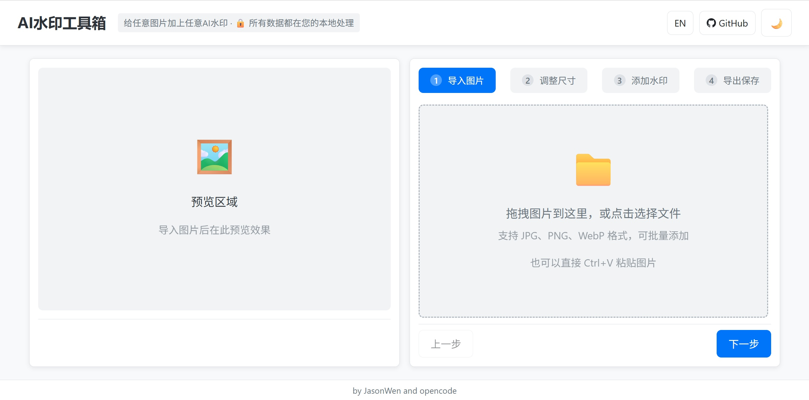

# VibeMark (AI水印工具箱)

**VibeMark** 是一款轻量级、高性能且注重隐私的 AI 水印工具箱。它支持一键为您的图片添加主流 AI 厂商的专业水印。作为一个单文件 HTML 应用，它完全在浏览器本地运行，确保您的图片数据永不离机。

## ✨ 核心亮点

- **一键 AI 水印**: 快速添加来自 Google, 字节跳动, 阿里巴巴, 百度, 腾讯等主流厂商的数十个渠道水印。
- **数百种预设**: 预置了多种 AI 生成平台的官方水印样式，支持批量处理。
- **隐私至至上**: 100% 本地处理，您的图片数据永不离机，保护创作隐私。
- **单文件应用**: 便携式 HTML 文件，无需安装，无任何外部依赖。

## 🚀 主要功能

- **主流厂商支持**: 涵盖 Gemini, 豆包, 通义千问, 文心一言, 混元等数十个品牌。
- **智能自动缩放**: 水印根据目标图片的分辨率自动调整大小和位置（推荐）。
- **精确控制**: 轻松微调位置、透明度、偏移量，并支持自定义文本和图片水印。
- **交互式编辑**: 集成裁切和缩放功能，支持直观的拖拽交互。
- **批量处理**: 同时处理多张图片，并支持一键打包导出 ZIP。

## 🛠️ 访问使用

您可以直接访问以下链接使用：
- [Cloudflare 镜像](https://vibemark.pages.dev/)
- [Vercel 镜像](https://vibe-mark-ivory.vercel.app/)
- [GitHub Pages](https://jasonwenthefox.github.io/VibeMark/)

或者下载本仓库的 `index.html` 后在本地浏览器中直接打开。

## 🚧 待办事项 & 缺失资源

我们正在征集以下缺失的厂商水印资源：
- **Grok** (xAI)
- **Adobe Firefly**

如果您拥有这些厂商或其他 AI 厂商的高质量（黑色背景）原始水印素材，欢迎提交 Issue 或 Pull Request！

## 🤝 贡献

欢迎任何形式的贡献！让我们一起把 VibeMark 做得更好。

## 📄 许可证

基于 MIT 许可证开源。
